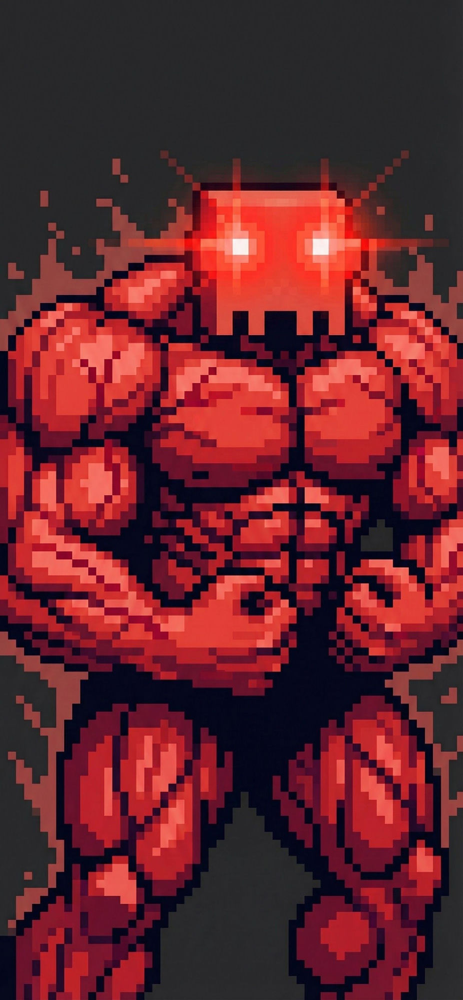

# Claw Code

<p align="center">
  <a href="https://github.com/ultraworkers/claw-code">ultraworkers/claw-code</a>
  ·
  <a href="./USAGE.md">Usage</a>
  ·
  <a href="./rust/README.md">Rust workspace</a>
  ·
  <a href="./PARITY.md">Parity</a>
  ·
  <a href="./ROADMAP.md">Roadmap</a>
  ·
  <a href="https://discord.gg/5TUQKqFWd">UltraWorkers Discord</a>
</p>

<p align="center">
  <a href="https://star-history.com/#ultraworkers/claw-code&Date">
    <picture>
      <source media="(prefers-color-scheme: dark)" srcset="https://api.star-history.com/svg?repos=ultraworkers/claw-code&type=Date&theme=dark" />
      <source media="(prefers-color-scheme: light)" srcset="https://api.star-history.com/svg?repos=ultraworkers/claw-code&type=Date" />
      
    </picture>
  </a>
</p>

<p align="center">
  
</p>

This repository contains FRIDAY, a local-first personal AI assistant. The Rust `claw` runtime is configured to use Ollama for local model inference by default.

> [!IMPORTANT]
> Start with [`USAGE.md`](./USAGE.md) for build, auth, CLI, session, and parity-harness workflows. Make `claw doctor` your first health check after building, use [`rust/README.md`](./rust/README.md) for crate-level details, read [`PARITY.md`](./PARITY.md) for the current Rust-port checkpoint, and see [`docs/container.md`](./docs/container.md) for the container-first workflow.

## Current repository shape

- **`rust/`** — canonical Rust workspace and the `claw` CLI binary
- **`USAGE.md`** — task-oriented usage guide for the current product surface
- **`PARITY.md`** — Rust-port parity status and migration notes
- **`ROADMAP.md`** — active roadmap and cleanup backlog
- **`PHILOSOPHY.md`** — project intent and system-design framing
- **`src/` + `tests/`** — companion Python/reference workspace and audit helpers; not the primary runtime surface

## Quick start

```bash
cd rust
cargo build --workspace
./target/debug/claw --help
./target/debug/claw prompt "summarize this repository"
```

Run with local Ollama (no paid API key required):

```powershell
ollama pull qwen3:4b
$env:OLLAMA_BASE_URL = "http://127.0.0.1:11434/v1"
$env:OLLAMA_MODEL = "qwen3:4b"
cd rust
cargo build -p rusty-claude-cli
.\\target\\debug\\claw.exe prompt "Say hello"
```

FRIDAY's default Rust agent path uses Ollama on localhost. The upstream CLI retains legacy OAuth utilities that are not needed for the FRIDAY local path.

Run the workspace test suite:

```bash
cd rust
cargo test --workspace
```

## Documentation map

- [`USAGE.md`](./USAGE.md) — quick commands, auth, sessions, config, parity harness
- [`rust/README.md`](./rust/README.md) — crate map, CLI surface, features, workspace layout
- [`PARITY.md`](./PARITY.md) — parity status for the Rust port
- [`rust/MOCK_PARITY_HARNESS.md`](./rust/MOCK_PARITY_HARNESS.md) — deterministic mock-service harness details
- [`ROADMAP.md`](./ROADMAP.md) — active roadmap and open cleanup work
- [`PHILOSOPHY.md`](./PHILOSOPHY.md) — why the project exists and how it is operated

## Ecosystem

Claw Code is built in the open alongside the broader UltraWorkers toolchain:

- [clawhip](https://github.com/Yeachan-Heo/clawhip)
- [oh-my-openagent](https://github.com/code-yeongyu/oh-my-openagent)
- [oh-my-claudecode](https://github.com/Yeachan-Heo/oh-my-claudecode)
- [oh-my-codex](https://github.com/Yeachan-Heo/oh-my-codex)
- [UltraWorkers Discord](https://discord.gg/5TUQKqFWd)

## Ownership / affiliation disclaimer

- This repository does **not** claim ownership of the original Claude Code source material.
- This repository is **not affiliated with, endorsed by, or maintained by Anthropic**.
