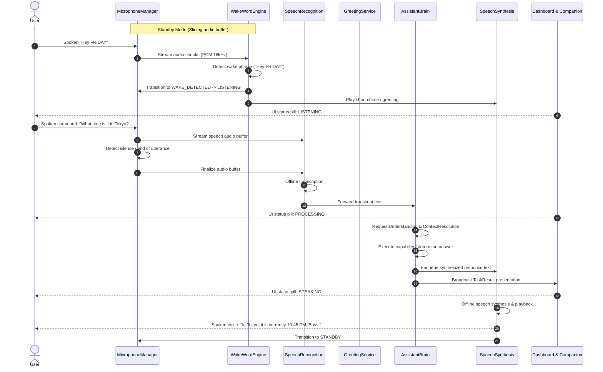

# FRIDAY — Phase 11 Architecture Specification
## Windows Native Voice Activation, Wake-Word Detection & Natural Assistant Experience

**Document Version:** 1.0.0  
**Phase:** 11.0  
**Target Platform:** Windows 11 (AMD Ryzen 7 8845HS, NVIDIA RTX 3050, 16 GB RAM)  
**Starting SHA:** `f90b62ac2fc3b4001ed5d074f15db65591f85859`  
**Authoritative Branch:** `main`

---

## 1. Executive Summary & Objective

FRIDAY Phase 11 elevates the assistant from a dashboard/companion-initiated system into a true Windows-native, persistent voice assistant.

The voice activation architecture integrates directly into FRIDAY's authoritative backend and Executive Brain without duplicating planning, memory, capability discovery, approvals, or result synthesis.

### Key Goals:
1. **Background Standby:** Run as a lightweight background service in Windows, with optional autostart on Windows boot.
2. **Local Wake-Word Detection:** Continuous, low-overhead listening in standby for configurable wake phrases ("Hey FRIDAY", "Hello FRIDAY", "Wake up FRIDAY", and time-aware greetings).
3. **Offline Speech Recognition (STT):** Offline transcription of user commands using local speech models (Whisper/Vosk) with silence detection, timeout, and CPU/GPU selection.
4. **Deterministic Time-Aware Personality:** Deterministic greeting selection using local Windows system time and configured IANA timezone (`Asia/Kolkata` default), addressing the user naturally as "Boss".
5. **Offline Speech Synthesis (TTS):** Interruptible local speech output with audio queuing, cancellation, and text fallback.
6. **Executive Brain Integration:** Full pipeline pass-through:
   $$\text{Microphone} \rightarrow \text{Wake Word} \rightarrow \text{Speech Recognition} \rightarrow \text{Request Understanding} \rightarrow \text{Context Resolution} \rightarrow \text{Executive Brain} \rightarrow \text{Policy/SafetyGate} \rightarrow \text{Capabilities} \rightarrow \text{Verification} \rightarrow \text{Synthesis} \rightarrow \text{TTS}$$
7. **Strict Privacy & Security:** No cloud audio streaming; hardware mute physically halts capture; sleep disables wake detection; high-risk actions remain gated by `SafetyGate` and persistent `ApprovalStore`.

---

## 2. Current Architecture vs. Phase 11 Additions

### Existing Foundations (Phases 1–10.1):
- **Executive Brain (`assistantBrain.ts`):** `RequestUnderstandingEngine`, `ContextResolutionEngine` (prompt-injection quarantine, memory boundaries), `ToolPlanner`, `ClarificationEngine` (persistent SQLite v8 table `pending_clarifications`).
- **Capability Registry (`capabilityRegistry.ts`):** Typed schemas, security invariants, risk levels, and 18+ tools.
- **Background Orchestrator (`backgroundOrchestrator.ts`):** Persistent DAG task engine, cancellation, step checkpointing.
- **Safety Gate & Approvals (`safetyGate.ts`, `approvalStore.ts`):** Exact action/argument binding, expiration, tokenized approval lifecycle.
- **Result Verification & Presentation (`resultVerifier.ts`, `displayManager.ts`):** Cryptographic verification and rich visual contracts.
- **Financial Intelligence & Trading Copilot (`financeService.ts`, `tradingService.ts`):** Deterministic accounting and risk management.
- **Android Companion (`friday_companion/`):** Paired mobile client with WebSocket event streaming.
- **Current Voice State (`voice/stt.ts`, `voice/tts.ts`):** Minimal browser Web Speech API bridge and optional online edge-tts script.

### Phase 11 Additions:
```
friday/src/voice/
├── voiceService.ts             # Master Voice Service lifecycle & coordination
├── voiceStateManager.ts        # Deterministic 11-state voice FSM
├── voiceSettings.ts            # Persistent/configurable voice settings & env loader
├── voiceEvents.ts              # Typed EventEmitter for voice lifecycle events
├── voiceHealth.ts              # Health diagnostics for audio, wake, stt, and tts
├── microphoneManager.ts        # Audio capture engine, mute control, VAD & silence detection
├── wakeWordEngine.ts           # Local wake-phrase acoustic/keyword detector
├── speechRecognition.ts        # Offline STT engine (Whisper/Vosk/Offline fallback)
├── speechSynthesis.ts         # Local TTS engine (Windows SAPI / Piper / Fallback queue)
├── voiceSessionManager.ts      # Active conversational voice turn manager
├── greetingService.ts          # Deterministic time-of-day & timezone greeting classifier
└── windowsLifecycle.ts         # Windows autostart registry, background mode & tray IPC
```

---

## 3. Finite State Machine (FSM)

The voice service operates under a strict 11-state state machine:

```
                  ┌───────────────┐
                  │   DISABLED    │
                  └───────┬───────┘
                          │ start()
                          ▼
                  ┌───────────────┐
       ┌─────────►│   STARTING    ├─────────┐
       │          └───────┬───────┘         │
       │                  │ ready           │ failure
       │                  ▼                 ▼
       │          ┌───────────────┐   ┌───────────┐
       │          │    STANDBY    │   │   ERROR   │
       │          └───────┬───────┘   └───────────┘
       │                  │ wake phrase detected
       │                  ▼
       │          ┌───────────────┐
       │          │ WAKE_DETECTED │
       │          └───────┬───────┘
       │                  │ session start
       │                  ▼
       │          ┌───────────────┐
       │    ┌────►│   LISTENING   │◄────┐ (clarification turn)
       │    │     └───────┬───────┘     │
       │    │             │ silence / timeout / speech end
       │    │             ▼
       │    │     ┌───────────────┐
       │    │     │  PROCESSING   │
       │    │     └───────┬───────┘
       │    │             │ response ready
       │    │             ▼
       │    │     ┌───────────────┐
       │    └─────┤   SPEAKING    ├─────┤ (done speaking / interrupted)
       │          └───────────────┘     │
       │                                ▼
       │                          ┌───────────┐
       │                          │  STANDBY  │
       │                          └───────────┘
       │
   (wake/unmute)
       │          ┌───────────────┐
       ├──────────┤   SLEEPING    │ (wake listening paused)
       │          └───────────────┘
       │          ┌───────────────┐
       ├──────────┤     MUTED     │ (hardware capture halted)
       │          └───────────────┘
       │
       │ stop()   ┌───────────────┐
       └──────────┤   STOPPING    │
                  └───────────────┘
```

### Valid State Transitions Table

| Current State | Valid Next States | Trigger |
| :--- | :--- | :--- |
| `DISABLED` | `STARTING` | Service enabled and initialized |
| `STARTING` | `STANDBY`, `ERROR`, `DISABLED` | Hardware & engines validated |
| `STANDBY` | `WAKE_DETECTED`, `SLEEPING`, `MUTED`, `STOPPING`, `ERROR` | Wake detected, sleep/mute invoked, or stop |
| `WAKE_DETECTED` | `LISTENING`, `STANDBY`, `ERROR` | Voice session initiated |
| `LISTENING` | `PROCESSING`, `STANDBY`, `MUTED`, `STOPPING`, `ERROR` | User finished speaking or timeout |
| `PROCESSING` | `SPEAKING`, `LISTENING` (clarification), `STANDBY`, `ERROR` | Executive Brain completed response |
| `SPEAKING` | `STANDBY`, `LISTENING` (multi-turn), `MUTED`, `STOPPING` | Finished speech playback or user interrupted |
| `SLEEPING` | `STANDBY`, `MUTED`, `STOPPING` | User wakes service via UI/CLI |
| `MUTED` | `STANDBY`, `SLEEPING`, `STOPPING` | User un-mutes microphone |
| `ERROR` | `STARTING`, `STOPPING`, `DISABLED` | Retry recovery or shutdown |
| `STOPPING` | `DISABLED` | Teardown complete |

Any transition not explicitly defined is strictly rejected with an invariant check.

---

## 4. End-to-End Pipeline & Data Flow



---

## 5. Component Responsibilities

### 5.1 `voiceService.ts`
- Singleton manager coordinating all sub-engines (`microphoneManager`, `wakeWordEngine`, `speechRecognition`, `speechSynthesis`, `voiceSessionManager`, `greetingService`).
- Manages startup, shutdown, recovery, state transitions, and integration into `FridayServer` and `index.ts`.

### 5.2 `microphoneManager.ts`
- Owns audio input stream capture.
- Enforces single microphone owner.
- Hardware-level mute control: physically closes/pauses audio stream buffers when muted.
- Voice Activity Detection (VAD) and energy-based silence detection.
- Configurable maximum recording duration (default: 30s) and silence timeout (default: 2.5s).

### 5.3 `wakeWordEngine.ts`
- Operates on continuous 16kHz mono audio stream in `STANDBY` state.
- Matches against normalized wake phrases:
  - `"hey friday"`, `"hello friday"`, `"wake up friday"`
  - `"good morning friday"`, `"good afternoon friday"`, `"good evening friday"`
- Separates wake phrases from trailing commands (e.g., "Hey FRIDAY, what time is it?" immediately dispatches "what time is it?" without redundant wake prompt).

### 5.4 `speechRecognition.ts` (STT)
- Offline speech-to-text engine.
- Supports local Whisper (`whisper.cpp` / `faster-whisper`), Vosk, or modular offline acoustic model.
- Includes offline fallback provider for simulated / testing environments.
- Normalizes punctuation and casing.

### 5.5 `speechSynthesis.ts` (TTS)
- Offline text-to-speech synthesis engine.
- Integrates Windows native SAPI (`System.Speech`), Piper, or Edge-TTS fallback.
- Features:
  - Speech queue (FIFO serialization, prevents overlapping speech).
  - Immediate interruption / cancellation (`stop()`).
  - Text sanitization (strips markdown, code blocks, JSON artifacts).

### 5.6 `greetingService.ts`
- Deterministic time-of-day greeting generator:
  - `05:00 - 11:59`: "Good morning"
  - `12:00 - 16:59`: "Good afternoon"
  - `17:00 - 20:59`: "Good evening"
  - `21:00 - 04:59`: "Good night / welcome back"
- Uses Windows system clock and IANA timezone (`Asia/Kolkata` default).
- Always addresses the user as "Boss" (or configured personality name).
- Produces natural variations while maintaining strict time boundaries.

### 5.7 `windowsLifecycle.ts`
- Manages Windows autostart via Windows Registry key:
  `HKCU\Software\Microsoft\Windows\CurrentVersion\Run\FRIDAY`
- Provides enable/disable autostart methods that are transparent, verified, and reversible.
- Provides background runner hooks and tray IPC status signals.

---

## 6. Security, Privacy & Resource Policies

### 6.1 Privacy Invariants:
1. **Local-First Audio:** Raw audio PCM buffers are processed in memory and never sent to cloud APIs.
2. **No Raw Audio Logging:** Raw audio is never persisted to disk or written to Winston logs.
3. **Physical Mute:** Muting stops recording buffers at the microphone manager level.
4. **Sleep State:** Disables the wake-word engine from processing incoming audio frames.
5. **Memory Policy:** Spoken transcripts pass through `shouldPersistConversationToMemory()` to quarantine sensitive inputs (passwords, tokens, API keys).

### 6.2 Security Invariants:
1. **No Authorization Bypass:** Voice input is treated as untrusted user input. It passes through `RequestUnderstandingEngine` and `SafetyGate`.
2. **Approval Enforcement:** High-risk actions (e.g. system commands, fund transfers, trading execution) require explicit persistent approval via `ApprovalStore`. Voice commands cannot bypass approval.
3. **Persistent Clarifications:** Clarification requests prompted by voice are stored in the SQLite `pending_clarifications` table and survive restarts.

### 6.3 Resource Budget (Target: Ryzen 7 8845HS, RTX 3050, 16 GB RAM):
- **Standby Mode:**
  - CPU usage: $< 1.5\%$ of 8-core CPU.
  - Memory: $< 180\text{ MB}$ RSS.
  - Zero continuous LLM inference in standby.
- **Active Transcription Mode:**
  - CPU usage: $< 15\%$ on CPU, or offloaded to RTX 3050.
  - Memory: $< 800\text{ MB}$ during active inference.
  - Automatic model idle unloading after 5 minutes of inactivity.

---

## 7. Testing Strategy

1. **Unit Tests (`friday/tests/voiceActivation.test.mjs`):**
   - State machine transition validity and illegal transition rejection.
   - Timezone-aware greeting classification and "Boss" persona constraints.
   - Wake phrase normalization and separation from compound commands.
   - Microphone mute and physical capture halt simulation.
   - Sleep / Wake lifecycle.
   - TTS queue serialization and interruption mechanics.
   - Windows autostart registry command generator (idempotent, reversible).
   - Clarification resumption via voice.
   - Approval gate boundary enforcement on voice commands.
2. **Integration Tests:**
   - Simulated audio stream $\rightarrow$ Wake detection $\rightarrow$ STT $\rightarrow$ Executive Brain $\rightarrow$ TTS.
   - WebSocket event broadcast of voice states (`voice:state_change`, `voice:transcript`, `voice:speaking`).
   - REST endpoints (`/friday/voice/status`, `/friday/voice/mute`, `/friday/voice/sleep`, `/friday/voice/wake`, `/friday/voice/autostart`).
3. **Hardware / Windows Device Validation Reporting:**
   - Real hardware audio devices reported honestly as `PASS`, `PARTIAL`, or `NOT TESTED` depending on sandbox constraints.

---

## 8. Implementation Stages

| Stage | Focus Area | Deliverables |
| :--- | :--- | :--- |
| **11.0** | Architecture & Design | `docs/PHASE_11_VOICE_ACTIVATION_ARCHITECTURE.md` |
| **11.1** | Voice Service & FSM | `voiceService.ts`, `voiceStateManager.ts`, `voiceSettings.ts`, `voiceEvents.ts`, `voiceHealth.ts` |
| **11.2** | Local Wake-Word Engine | `wakeWordEngine.ts`, `microphoneManager.ts` |
| **11.3** | Offline STT Engine | `speechRecognition.ts`, model loader, VAD/silence detector |
| **11.4** | Time-Aware Greeting Engine | `greetingService.ts`, timezone resolution, "Boss" personality rules |
| **11.5** | Local TTS & Interruption | `speechSynthesis.ts`, audio queue, interruption handler |
| **11.6** | Windows Lifecycle & Autostart | `windowsLifecycle.ts`, registry autostart manager |
| **11.7** | Executive Brain Integration | Voice pipeline connected to `AssistantBrain`, clarification & approvals |
| **11.8** | Dashboard & API Integration | REST routes `/friday/voice/*`, WebSocket events, UI voice card |
| **11.9** | Configuration & Security Hardening | Config extensions in `config.ts`, privacy guards, resource limits |
| **11.10** | Validation & Completion Report | `voiceActivation.test.mjs`, `docs/PHASE_11_COMPLETION_REPORT.md` |
